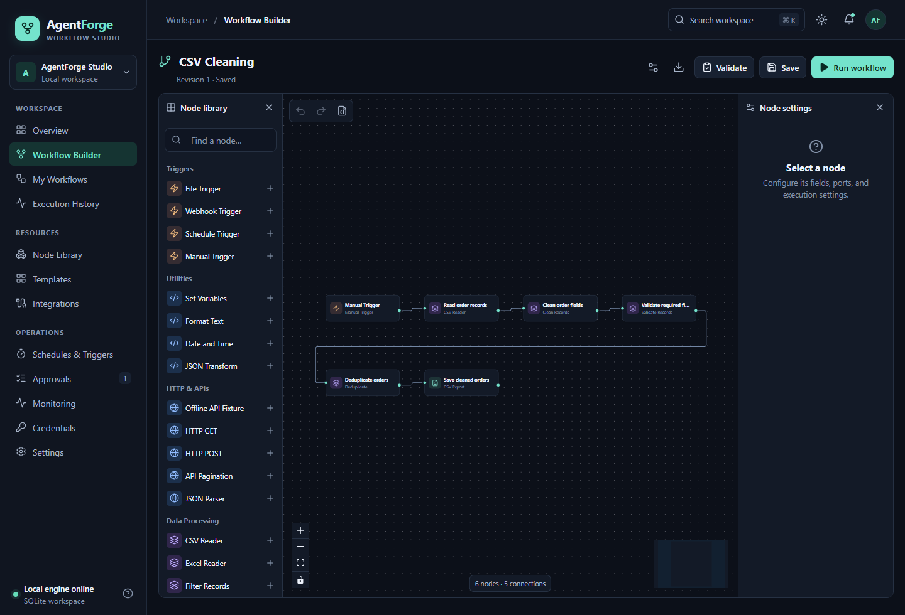
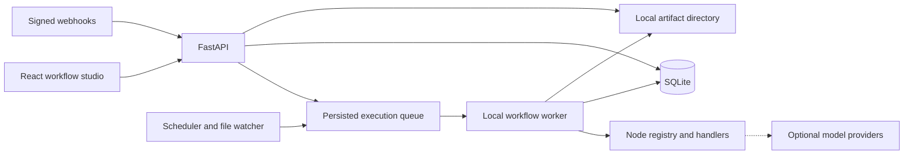

# AgentForge — Visual AI Workflow Automation Platform

**Design. Automate. Execute. Monitor.**

AgentForge is a local workflow studio for recurring data processing, reporting, and review tasks. Use the visual builder to compose a directed acyclic graph (DAG), then run it manually or from a trigger. The engine pins each run to a saved workflow revision and records node outcomes, routing decisions, and downloadable artifacts.

## Key capabilities

- Build, validate, import, export, and duplicate workflow drafts in a drag-and-drop editor.
- Start executions manually, on a schedule, from a watched input directory, or through a signed webhook.
- Pause for human review and resume through the port for the recorded decision.
- Inspect execution history, node checkpoints, and metrics calculated from persisted run data.
- Generate CSV, XLSX, JSON, text, and PDF outputs. Process text offline or configure an optional model provider.

## Application showcase



[Overview](docs/screenshots/01-overview.png) · [Execution history](docs/screenshots/05-history.png) · [Node library](docs/screenshots/07-node-library.png) · [Templates](docs/screenshots/08-templates.png) · [Approvals](docs/screenshots/09-approvals.png) · [Monitoring](docs/screenshots/10-monitoring.png)

[Sample PDF report](docs/sample-agentforge-report.pdf) · [Sample CSV](docs/samples/orders.csv) · [Sample Excel workbook](docs/samples/sales-leads.xlsx)

## Architecture



The local worker, scheduler, and file watcher run in the backend process. The optional distributed configuration uses PostgreSQL for shared state, Redis for Celery delivery, and shared filesystem storage for artifacts. [Architecture](docs/ARCHITECTURE.md) · [Data models](docs/DATA_MODELS.md) · [Deployment](docs/DEPLOYMENT.md)

## Workflow execution

1. Compose a draft and validate its node settings, connections, and dependency order.
2. Submit a run. The engine pins a workflow version and persists the run before dispatch.
3. Evaluate ready nodes and record their inputs, outputs, and emitted ports. Only matching edges activate.
4. Persist pending reviews and release the worker. A valid decision requeues the run and selects its branch.
5. Record the terminal state and expose generated artifacts through the execution API. [Workflow engine](docs/WORKFLOW_ENGINE.md) · [API reference](docs/API_REFERENCE.md)

## Workflow reliability

Approval resumes the same pinned execution and reuses committed node checkpoints. The first valid decision wins, and a repeated decision returns HTTP 409. A replayable failed node can resume in place. Starting a new run from the pinned version creates a separate execution. An interrupted external write with an unknown outcome requires provider reconciliation. See the [reliability audit, test results, and screenshots](docs/WORKFLOW_RELIABILITY.md).

## Technology stack

| Layer | Technologies |
| --- | --- |
| Studio | React, TypeScript, Vite, React Flow, TanStack Query, Zustand, Recharts |
| API and persistence | FastAPI, Pydantic, SQLAlchemy, Alembic, SQLite |
| Scheduling and outputs | APScheduler, OpenPyXL, ReportLab |
| Optional integrations | Playwright, Ollama, OpenAI-compatible APIs, PostgreSQL, Redis, Celery |

## Automation nodes

The catalog includes manual, schedule, webhook, and file triggers, along with data transformation, branching, templating, allowlisted HTTPS, static browser extraction, human approval, AI-assisted processing, and report export. [Node catalog](docs/NODE_CATALOG.md)

## Demonstration workflows

| Example | Output or behavior |
| --- | --- |
| API to CSV, CSV Cleaning, Lead Data Preparation | Normalize source data and export CSV or Excel |
| Daily Business Report, Price Monitoring | Aggregate sample data and generate a report |
| Data Quality Automation | Separate valid and quarantined records |
| Purchase Approval | Pause the run and route the recorded decision |
| AI Document Processing | Apply deterministic text processing to a sample memo |
| Website Data Extraction | Read bundled HTML with Playwright and export a table |

## Windows quick start

Run from the repository root in PowerShell with Python 3.12 or 3.13 and Node.js 20.19+ or 22.12+:

```powershell
python -m venv .venv
.\.venv\Scripts\python.exe -m pip install -r backend/requirements.txt
npm.cmd --prefix frontend ci
npm.cmd --prefix frontend run build
$env:AGENTFORGE_ROOT = Join-Path $PWD '.runtime'
.\.venv\Scripts\python.exe -m alembic -c backend/alembic.ini upgrade head
.\.venv\Scripts\python.exe -m scripts.seed_demo --skip-browser
.\.venv\Scripts\python.exe -m uvicorn backend.app.main:app --host 127.0.0.1 --port 8000
```

Open [AgentForge](http://127.0.0.1:8000/). Import **CSV Cleaning** under **Templates**, run it in the builder, and open the execution to download the result. For the browser example, set `AGENTFORGE_BROWSER=chrome` in the backend environment and omit `--skip-browser` when seeding. [Quick start](docs/QUICKSTART.md) · [Troubleshooting](docs/TROUBLESHOOTING.md)

## Testing and verification

The release passed 63 backend tests and three frontend tests, plus Ruff, TypeScript, and the production build. The Python and npm production dependency audits reported zero known advisories. See the [verification report](docs/FINAL_VERIFICATION_REPORT.md). The [CI workflow](.github/workflows/ci.yml) defines backend, frontend, and dependency checks.

## Performance benchmarks

| Workflow | Baseline mean | Latest measured mean |
| --- | ---: | ---: |
| Five nodes | 263.14 ms | 736.80 ms |
| 100 nodes | 7.43 s | 10.75 s |

Each mean uses three successful trials on Windows 11 with four logical processors, Python 3.13.2, SQLite, and one worker. The latest comparison used Winloop, ran during other verification work, and predates the final framework pins. Timing includes persistence and allocation tracing. These measurements describe the local fixture workload. [Raw results and methodology](evaluation/reports/BENCHMARK_REPORT.md) · [Reproduction commands](docs/BENCHMARKS.md)

## Security model

AgentForge assumes one trusted local operator. Bind the application to loopback. Outbound destinations use exact HTTPS allowlists, webhooks validate signatures and event IDs, files are confined to configured roots, and credentials use environment references. [Security controls and deployment requirements](docs/SECURITY.md)

## Known limitations

Live model inference, live browser destinations, and the PostgreSQL, Redis, and Celery service stack need further verification. Browser nodes extract static content. The current interface has no multi-user identity or tenant isolation. [Project status](PROJECT_STATUS.md)

## Future development

- Verify worker ownership and recovery with real PostgreSQL and Redis services.
- Measure repeatable workloads with an idle host and the published dependency set.
- Add identity and tenant isolation before supporting shared deployments.

## Author

Faizan Akhtar · [GitHub](https://github.com/Faizan-AiEngineer) · [LinkedIn](https://www.linkedin.com/in/faizanakhtar-/)

Third-party dependencies are distributed under their respective licenses. [Case study](docs/CASE_STUDY.md) · [Portfolio materials](docs/PORTFOLIO_MATERIALS.md)