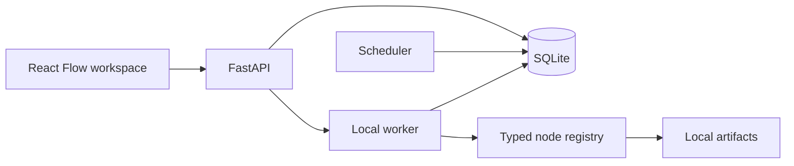
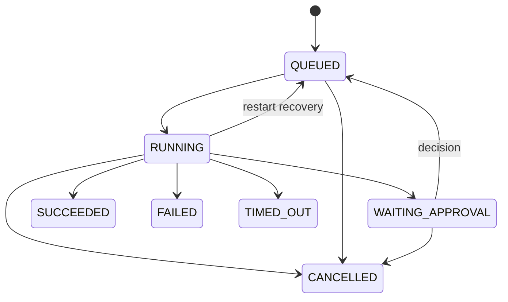
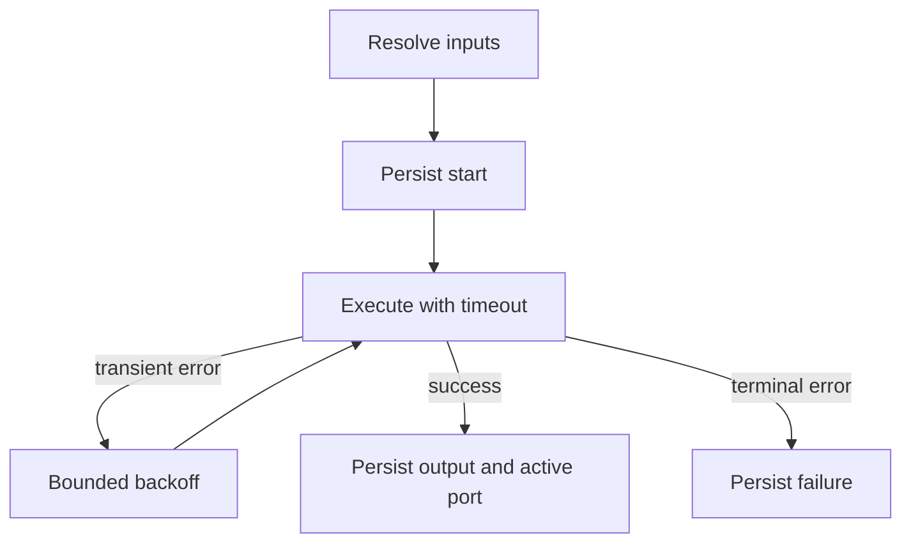
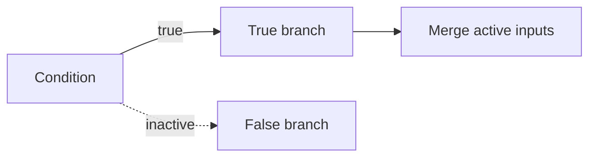
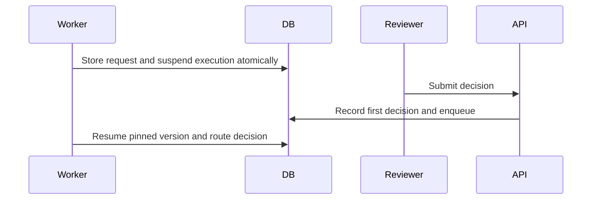
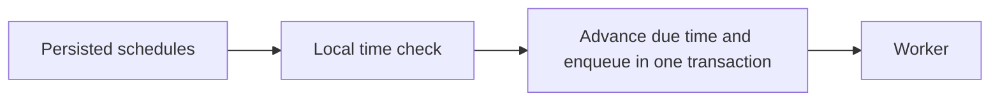
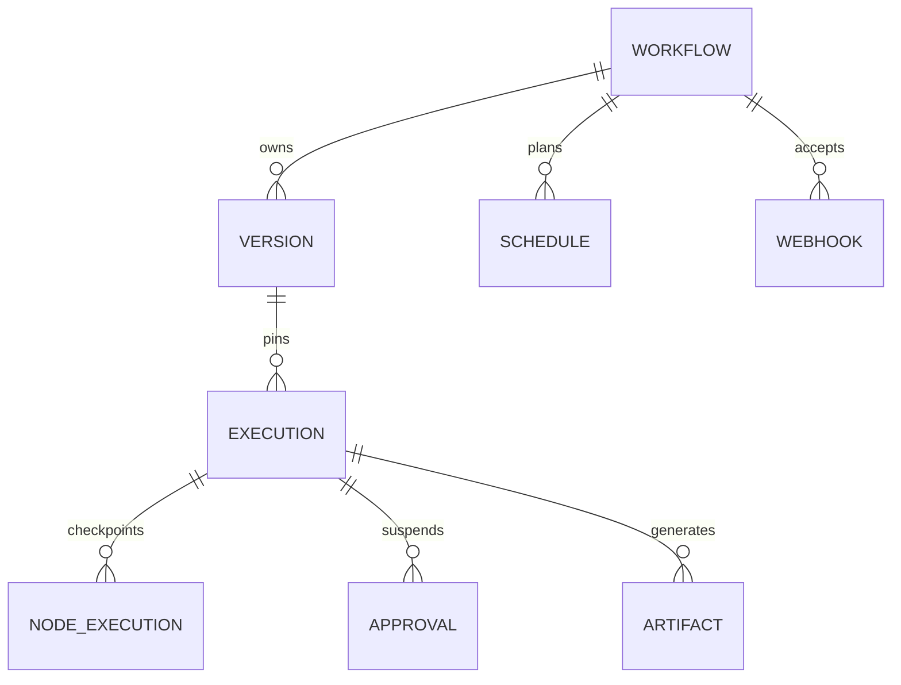
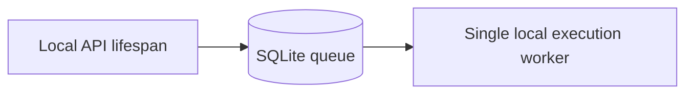
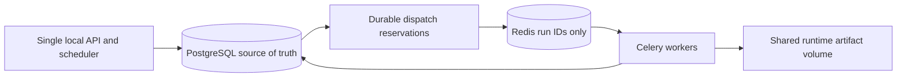

# Architecture

AgentForge is a single-user automation workspace. The local React client talks to a loopback FastAPI API. SQLAlchemy stores workflow drafts, immutable runnable versions, executions and checkpoints. One local worker consumes the durable queue and releases its slot during approvals. A separate artifact root contains generated files.

Workflow nodes and edges are normalized by Pydantic and stored together inside each graph snapshot. The public API uses JSON models under /api/v1. The builder reads registry schemas and sends the same graph contract used by imports, templates and executions. Drafts can be saved before validation. An execution pins a validated revision.

The two executors share the runner and workflow state transitions. The distributed dispatcher reserves eligible rows before publishing just their run IDs. A PostgreSQL advisory lock protects each run during worker execution. Worker heartbeats register availability in PostgreSQL. A lost message becomes eligible again when its reservation expires, and a failed worker releases ownership when its database session ends.

Browser nodes fetch administrator-approved pages through the pinned HTTPS transport and render the resulting static markup in an offline Playwright context. AI nodes use model allowlists and provider-specific adapters with a shared bounded task contract. The local SQLite default starts without a provider or broker.
