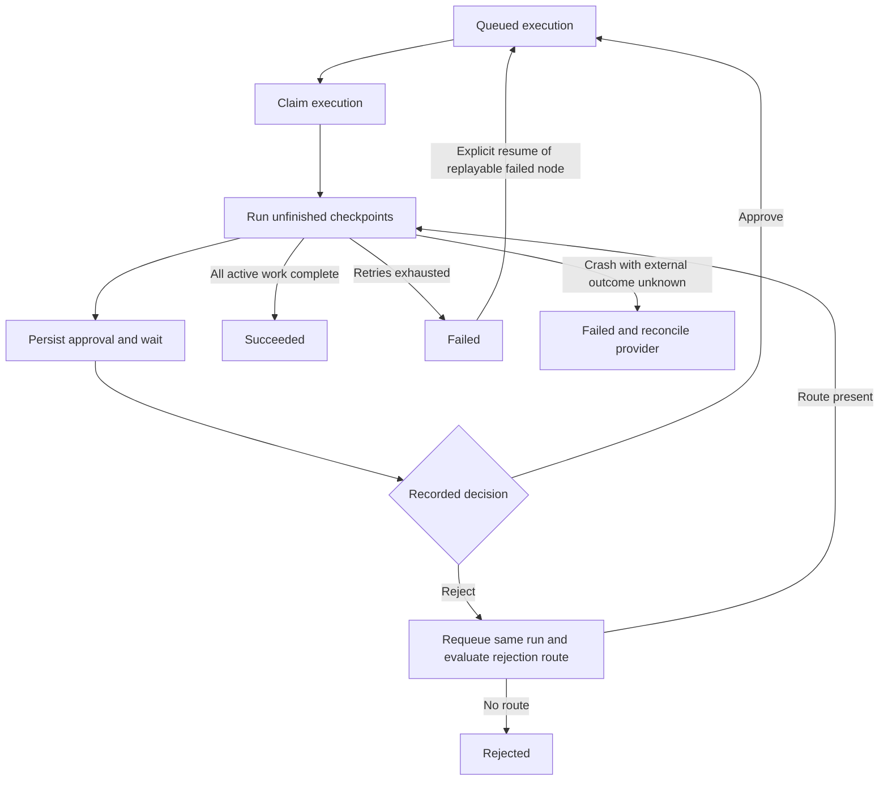

# Workflow reliability

The review asked whether resuming after human approval can repeat an action that already completed.

## Existing implementation before this audit

The runner topologically orders a pinned DAG and writes one checkpoint per execution and node. A committed successful or skipped checkpoint is bypassed when the runner traverses the graph again. The approval decision updates the pending approval row and requeues the same execution. Repeated decisions return HTTP 409. The local backend owns a worker lock and uses an atomic queued-to-running claim. Distributed delivery also uses PostgreSQL advisory ownership. These are distinct concurrency mechanisms.

The original automatic retry policy applies only to replayable nodes and uses bounded retries for transient runtime errors and timeouts. The explicit Retry action creates a new execution for the pinned workflow. External POST is non-replayable and interrupted attempts fail with an unknown-outcome message. Export paths are deterministic per execution and node, with an atomic file rename before the SQL checkpoint. A crash can leave a file without a completed database entry.

Before this audit, tests already exercised approval routing after restart, duplicate decisions, basic retries, interrupted non-replayable work, and simulated queue delivery. They did not run a six-node pre-approval write with action counters, concurrent decisions across real database transactions, two approval checkpoints in one run, or a crash after all simulated external effects had committed.
## Changes from this audit

The primary test passed on the original engine. The expanded suite initially passed seven of ten cases and reproduced three gaps. The original engine had no way to resume the same run after a replayable node exhausted its retries. A rejection without a connected rejection branch left the run labeled successful. An interrupted local file export reused the artifact path correctly, but recovery reused the previous attempt number in history.

- **Resume failed node** makes one new attempt at a replayable failed checkpoint in the original pinned execution. It keeps upstream checkpoints, approval decisions and artifact IDs. The API atomically claims the failed state using the execution ID and its failure timestamp, resets the deadline to the pinned workflow timeout, and requeues the execution. Ineligible states and duplicate claims return HTTP 409. A later failure can be recovered explicitly again.
- **Start new run from pinned version** retains the existing retry endpoint and creates an entirely separate execution. Workflows containing a non-replayable external write still cannot use this path. The UI displays only the recovery options supported by the backend.
- Unrouted rejection ends the run as **Rejected** and leaves approval-gated downstream nodes skipped. Existing workflows that explicitly route the rejection can still run their rejection branch and complete successfully.
- Recovered replayable actions increment the persisted attempt counter. Consuming an already-recorded approval resolves the paused logical attempt. The graph and timeline show pending nodes during approval and preserve completed checkpoints after resumption.
- The approval inbox prevents a second click while a decision request is in flight. The database still decides which request wins when clients bypass the UI.
- An interrupted non-replayable external action, a timeout at that boundary, or a failure while saving its returned result can require provider reconciliation. No new schema or infrastructure was required.

## Lifecycle



## Persistence and side-effect boundaries

The execution ID and DAG node ID identify a logical operation. The DAG validates unique IDs and disallows cycles. A batch node groups data within one invocation. A future loop mechanism would need to include a stable invocation identity in its checkpoints.

SQLite stores the pinned workflow version, approval decision, latest node state, attempt count, and artifact reference. There is at most one successful checkpoint and one artifact reference for a node within an execution. Approval, automatic retry, startup recovery and explicit resumption all consult completed checkpoints before starting work. The attempt counter records starts rather than a full event log for each individual attempt. A new execution has a separate logical identity.

Replayable actions can run more than once after interruption. The local export uses a deterministic per-node path and atomic replacement, so retrying the write leaves one visible output. SQL does not commit atomically with the filesystem or with external services. If an external receiver may have accepted a request before the checkpoint was saved, AgentForge stops that execution at the failed checkpoint. Check the provider receipt or authoritative record before deciding how to reconcile the operation. Any provider-supported deduplication or idempotency guarantee must be verified with that provider. The synthetic receiver used for this audit deliberately deduplicates nothing.

The distributed path uses PostgreSQL ownership and queued delivery. The existing local test simulates duplicate delivery. Live PostgreSQL, Redis, and Celery were outside this audit. The crash tests recreate the backend after cancelling the worker at a controlled boundary. They exercise checkpoint recovery in SQLite and do not establish power-loss durability guarantees.

## Reproducing the regression suite

The targeted test module runs the six-node fixture with real node actions and queries durable artifact rows and files. The simulated network receiver substitutes only the transport boundary of the approved HTTP POST node. It records one synthetic email, database insert, webhook and file write using a separate local ledger. Release counters are derived from persisted checkpoints and receiver records.

```powershell
python -m pytest -q backend/tests/test_workflow_resumption_idempotency.py -o junit_family=xunit1 --junitxml D:/agentforge-resumption-results.xml
```

For the browser replay, build the frontend and run the existing ASGI verification command with the screenshot flag. Chrome renders the production bundle and requests the real FastAPI application through the test harness.

```powershell
python -m scripts.verify_browser_asgi --channel chrome --runtime D:/agentforge-browser-verification --resumption-screenshots D:/agentforge-resumption-screenshots
```

## Verification results

The existing Windows backend suite passed 63 tests. After the changes, all 73 backend tests passed, including 10 new regressions. The final run had zero failures and zero skips. The frontend passed three Vitest tests, TypeScript, and the production build. Ruff passed. All nine existing demos succeeded and the intentionally paused fixture remained waiting for review. Chrome also verified the downloaded artifact bytes and native save flow.

| Scenario | Expected and observed outcome | Logical completions | Attempts | Local artifacts | Simulated external effects | Result |
| --- | --- | ---: | ---: | ---: | ---: | --- |
| Six-node approval workflow | Same execution, unchanged checkpoints, one pre-approval output row and one report | 6 | 6 | 2 | 0 | Pass |
| Duplicate approval | HTTP 200, then 409 on both repeats. One downstream execution | 6 | 6 | 2 | 0 | Pass |
| Restart during approval | Backend reopened the same SQLite database and resumed the original run | 6 | 6 | 2 | 0 | Pass |
| Concurrent approval | Two independent transactions synchronized before deciding. One committed a transition | 6 | 6 | 2 | 0 | Pass |
| Failure after approval | Report exhausted two attempts, then the same execution succeeded on its third report attempt | 6 | 8 | 2 | 0 | Pass |
| Multiple approvals | Two checkpoints in one execution. The second approval reused the completed report | 7 | 7 | 2 | 0 | Pass |
| Rejection | Reached Rejected. Both approval-gated nodes were skipped | 4 | 4 | 1 | 0 | Pass |
| External side effects | One simulated email, database write, webhook and output file despite a later report retry | 6 | 7 | 2 | 4 | Pass |
| Crash after external action | Receiver committed all four effects. Recreated backend marked the run failed and blocked both recovery routes | 4 | 5 | 1 | 4 | Pass |
| Crash after local file rename | Two report attempts recorded and one report artifact committed | 6 | 7 | 2 | 0 | Pass |

The browser verification exercised paused and pending states, approved and rejected decisions, successful and failed runs, and the final timeline. Two rapid clicks produced one decision request. The shared workflow fixture produced these four screenshots:

1. [Waiting for approval](screenshots/workflow-reliability/01-waiting-for-approval.png)
2. [History before approval](screenshots/workflow-reliability/02-history-before-approval.png)
3. [Resumed execution](screenshots/workflow-reliability/03-resumed-execution.png)
4. [Final execution history](screenshots/workflow-reliability/04-final-execution-history.png)

Further validation could cover live distributed recovery and per-attempt audit records. Provider-specific reconciliation can be tested when a documented idempotency or receipt interface is available.
